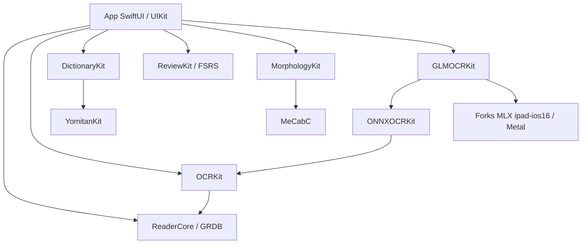

<!-- SPDX-License-Identifier: MIT -->
<!-- Copyright (c) 2026 NOxygen59 -->

# Guide développeur et architecture

## Contrat de compatibilité

Produit personnel pour un iPad M1 sous iOS 16.6.1. Le minimum déclaré est **iOS 16.0** ; les packages déclarent aussi macOS 14 pour leurs tests. Le SDK installé sur le Mac et le système de l'appareil sont deux contraintes différentes. Compiler avec un SDK récent ne rend pas ses API disponibles sur iOS 16.

Ne pas retirer une fonction ou désactiver les contrôles d'availability pour faire passer une compilation. Les forks MLX `ipad-ios16` apportent les équivalents nécessaires. Leurs correctifs font partie du produit et nécessitent une preuve Mac puis une recette iPad. Mac Catalyst est écarté dans les décisions actuelles.

## Préparer l'environnement

Lire `AGENTS.md`, la feuille de route en entier, puis [IA locale](IA-LOCALE.md) avant un travail sur les modèles. Inspecter l'état Git et les derniers commits avant d'éditer. Utiliser un checkout propre et une branche par intervention ; garder modèles, dictionnaires, PDF et journaux privés hors Git.

Outils du projet : Xcode complet et son environnement en ligne de commande, Swift compatible avec les manifestes `swift-tools-version: 5.10`, XcodeGen ; `ldid` uniquement pour le paquet TrollStore. Ne pas installer un runtime de simulateur ni piloter un appareil sans autorisation. Les tests de package sur Mac n'exigent pas de simulateur.

```sh
git status --short
xcodebuild -version
xcrun swift --version
xcodegen --version
```

Consigner ces versions avec les preuves. Ne pas transformer « outils disponibles le 25/10 » en prérequis reproductible éternel : la qualification d'une version précise appartient à la CI.

## Carte des responsabilités

| Élément | Responsabilité et dépendances |
|---|---|
| `App/` | SwiftUI/UIKit, intégration du stockage et des services, cycle de vie |
| `ReaderCore` | Modèles, GRDB, import PDF, réglages, repères et logique de lecture |
| `OCRKit` | Service OCR, modèles de résultats/boîtes, correction, comparaison, catalogue des modèles |
| `ONNXOCRKit` | Moteurs NDLOCR, PP-OCR, nettoyage et mise en page via ONNX Runtime |
| `YomitanKit` | Déconjugaison et règles portées sous GPL ; séparation et notices à conserver |
| `DictionaryKit` | Import/recherche/rendu de dictionnaires ; GRDB, ZIPFoundation, YomitanKit |
| `ReviewKit` | Cartes, planification FSRS, médias et exports ; base indépendante |
| `MeCabC` | MeCab C/C++ tiers, standard C++14 dans KyokashoKit |
| `MorphologyKit` | Interface Swift vers MeCab, extraction UniDic |
| `GLMOCRKit` | MLX, lecteurs Ovis/GLM/Qwen et tokenizer ; package séparé pour isoler la compilation lourde |



Le diagramme simplifie les dépendances ; les manifestes sont la source exacte. `App` possède encore des règles métier et de l'orchestration qui ne sont pas couvertes par les cibles de test de package.

## Parcours à suivre dans le code

**Import** : `AppModel.importFiles` / Drive → `DocumentImporter` → PDF local et `LibraryDocument` → scan des pages manquantes via `DocumentScan`. Le PDF est conservé comme source visuelle.

**Lecture** : `ReaderScreen` héberge PDFKit ; `ReaderController` garde l'état et les notifications. Les extensions `+Display`, `+Navigation`, `+OCR`, `+Verification`, `+Annotations`, `+PageLayout`, `+Search` séparent les thèmes, mais partagent le même objet. `PageFrame` porte les conversions de repère : ne pas recalculer arbitrairement les coordonnées dans chaque vue.

**Texte** : `OCRService` produit des lignes et boîtes enregistrées dans `ocrResult`. `DocumentAITextStore` stocke les lectures Markdown et applique la normalisation à la lecture. `ARCHITECTURE-LECTURE.md` fixe les contrats : PDF original intact, brut IA intact, correction manuelle protégée, invalidation après relecture.

**Étude** : `StudyPanel` et les vues texte utilisent OCR, Markdown et analyse japonaise ; le chat appelle `DocumentKnowledge` pour sélectionner les passages avant génération. Les pages explicitement demandées passent par les étiquettes `pageLabel`, pas par une addition aveugle de 1.

**Ajout de pages** : `AddPagesView` → `PageShift.apply` → transaction GRDB → remplacement du PDF → rapport → fichiers IA → base des cartes. Il n'y a pas de transaction globale entre toutes ces ressources ; le journal compense partiellement cette limite. Toute évolution exige une preuve d'interruption, pas seulement un test SQL.

## Concurrence et durée de vie

- `AITaskCenter` possède des tâches indépendantes des vues ; `DocumentAnalysisService` possède l'analyse du document. Fermer une vue n'est pas nécessairement annuler le travail.
- Un `actor` peut être réentré à chaque `await`. Préserver la mutualisation des chargements MLX et vérifier l'état après suspension.
- `Task.detached` ne récupère pas automatiquement l'annulation du parent. Propager explicitement arrêt et erreurs ; ne pas publier un résultat partiel comme définitif.
- PDFKit n'est pas supposé utilisable librement depuis plusieurs threads : respecter les mécanismes existants dont `PDFPool`.
- Les modèles MLX sont chargés exclusivement via `GLMModel` ; une lecture active ne doit pas subir un déchargement. Les caches ONNX suivent une autre durée de vie.
- Les mises à jour SwiftUI doivent respecter le fil principal et ne pas publier pendant `body`. Éviter d'élargir les états publiés sans mesure du coût.

## Compiler sans installer

Pour les packages, voir [TESTS.md](TESTS.md). Pour une compilation générique iOS sur un checkout de travail disposant des dépendances validées :

```sh
xcodegen generate --quiet
mkdir -p Kyokasho.xcodeproj/project.xcworkspace/xcshareddata/swiftpm
cp Packages/GLMOCRKit/Package.resolved Kyokasho.xcodeproj/project.xcworkspace/xcshareddata/swiftpm/Package.resolved
xcodebuild -project Kyokasho.xcodeproj -scheme Kyokasho \
  -configuration Debug -destination 'generic/platform=iOS' \
  -derivedDataPath build/documentation-check \
  -onlyUsePackageVersionsFromResolvedFile \
  CODE_SIGNING_ALLOWED=NO build
```

Cette commande compile pour l'appareil sans l'installer, sans exécuter l'app et sans démarrer un simulateur. Elle est une procédure proposée, pas une compilation effectuée par le lot documentaire. Une résolution manquante peut nécessiter un accès réseau ; conserver les journaux et contrôler les fichiers résolus après l'opération.

`build_ipa.sh` génère une archive Release, recopie les épingles du package GLMOCRKit, pseudo-signe via ldid et crée le `.tipa`. Il remplace des artefacts existants dans `build/ipa` et `dist`. Ne pas le lancer pour un simple contrôle documentaire ni avant d'avoir sauvegardé les dSYM utiles à un crash.

## Dépendances et licences

KyokashoKit dépend notamment de GRDB (plage `from: 7.11.1`), ZIPFoundation (`from: 0.9.20`), ONNX Runtime (exact `1.24.2`) et swift-fsrs (révision). GLMOCRKit dépend du fork mlx-swift-lm par branche et de swift-transformers exact `1.3.5`. Les `Package.resolved` portent les révisions effectives : une branche n'est pas une épingle immuable sans ces fichiers.

Pour mettre à jour : lot dédié, état initial des deux résolutions, examen des changelogs/correctifs iOS 16, tests ciblés, compilation générique, puis essai réel demandé à NOxygen59. Ne pas lancer `swift package update` au début d'une simple vérification. Les anciennes instructions de `IA-LOCALE.md` qui mettent à jour les packages sont des procédures de maintenance, pas la voie d'une reproduction figée.

Le code original est MIT ; cela ne remplace pas les licences des composants portés, modèles ou dictionnaires. Consulter `THIRD_PARTY_NOTICES.md`, `LICENSES/` et les crédits de l'app. La séparation d'un module GPL ne suffit pas, à elle seule, à conclure aux conditions d'une éventuelle redistribution ; tout changement de distribution demande une revue spécifique.

### Lexique du design d'intérieur (sources ouvertes)

`tools/build_domain_lexicon.py` fabrique, sur le Mac, un petit dictionnaire Yomitan tiré du Wiktionnaire en français (sens en français) et de Wikipédia en japonais (titres équivalents en français et en anglais, première phrase). Les deux sources sont sous CC BY-SA 4.0 : l'attribution est écrite dans `index.json` et chaque entrée donne l'adresse de sa page. Le dossier de travail et le `.zip` restent **hors du dépôt** ; le fichier se publie à part, avec l'accord de NOxygen59.

```bash
python3 tools/build_domain_lexicon.py fetch --raw <dossier-hors-dépôt>/brut
python3 tools/build_domain_lexicon.py build --raw <dossier-hors-dépôt>/brut --output <dossier-hors-dépôt>/lexique-interieur.zip
```

Le relevé envoie une requête par seconde et réessaie si le site demande d'attendre. Les catégories relevées sont en tête du script. Tests sur pages fabriquées : `tests/test_build_domain_lexicon.py`.

## Documenter Swift, C et C++

Un commentaire utile explique un contrat, la propriété mémoire, un invariant, une limite de plateforme ou la raison d'un choix. Commenter chaque ligne répète le code, masque les précautions utiles et devient rapidement faux lors des modifications. Préférer des noms clairs et des fonctions courtes, puis documenter les interfaces et décisions.

En Swift, utiliser `///`, paramètres, valeur de retour, erreurs, isolation et exemple pour les API publiques significatives. DocC est une option future pour naviguer ces API ; aucun site DocC n'est généré dans ce lot. En C/C++, des commentaires Doxygen `/** ... */` peuvent décrire `@param`, `@return`, `@throws` si applicable, la durée de validité des pointeurs et la fonction qui libère une ressource. Ne pas réécrire massivement les commentaires MeCab tiers.

Exemple de contrat à renseigner sur une interface mémoire : « pointeur emprunté valide jusqu'au prochain appel ; ne pas libérer ; accès sérialisé par le verrou ». Pour les bridges, préciser encodage UTF-8, index UTF-16 côté Swift, valeurs nulles et libération en cas d'initialisation partielle. Une explication de l'algorithme se place près de son point difficile ; une décision d'architecture va dans une note datée reliée au code.
